# Project Build Flowchart - Step-by-Step Development Guide

## Complete Guide: Building Multi-Tenant Asset Manager from Scratch

---

## 🚀 PROJECT INITIALIZATION FLOW

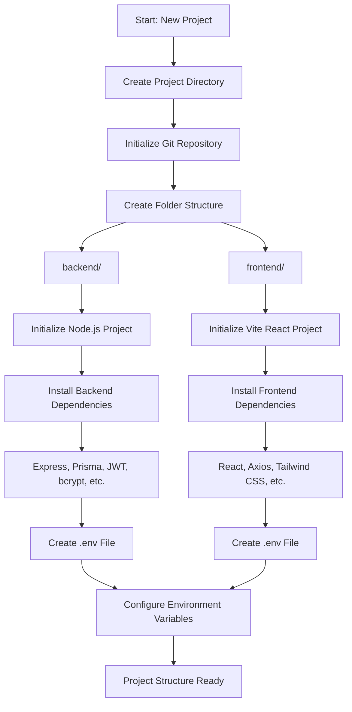

---

## 🗄️ DATABASE SETUP FLOW

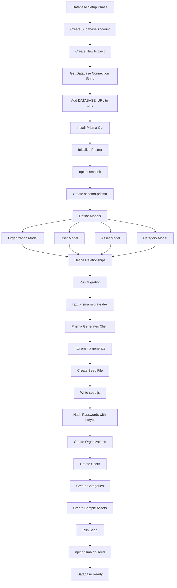

---

## 🔧 BACKEND DEVELOPMENT FLOW

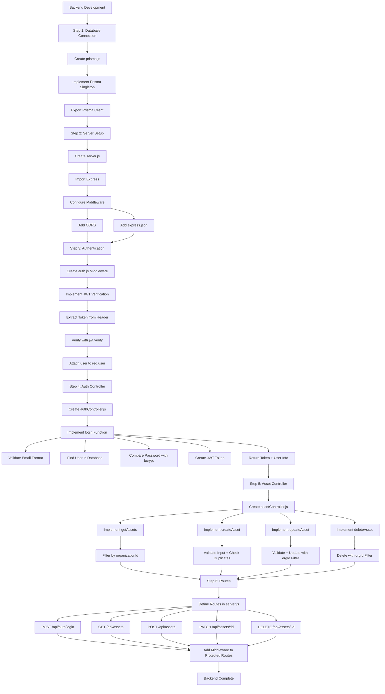

---

## 🎨 FRONTEND DEVELOPMENT FLOW

```mermaid
flowchart TD
    A[Frontend Development] --> B[Step 1: API Configuration]
    B --> C[Create api/axios.js]
    C --> D[Create Axios Instance]
    D --> E[Set baseURL]
    E --> F[Add Request Interceptor]
    F --> G[Get Token from localStorage]
    G --> H[Add Authorization Header]
    
    H --> I[Step 2: Root Component]
    I --> J[Create App.jsx]
    J --> K[Add Authentication State]
    K --> L[useState for isLoggedIn]
    L --> M[Check localStorage for Token]
    
    M --> N[Conditional Rendering]
    N --> O[If Not Logged In: Show Login]
    N --> P[If Logged In: Show Dashboard]
    
    O --> Q[Step 3: Login Component]
    P --> R[Step 4: Dashboard Component]
    
    Q --> S[Create Login.jsx]
    S --> T[Add Form State]
    T --> U[Email + Password Fields]
    U --> V[Handle Form Submit]
    V --> W[POST /api/auth/login]
    W --> X[Store Token in localStorage]
    X --> Y[Call onLoginSuccess]
    
    Y --> R
    
    R --> Z[Create Dashboard.jsx]
    Z --> AA[Add State Management]
    
    AA --> AB[assets: useState]
    AA --> AC[loading: useState]
    AA --> AD[isModalOpen: useState]
    
    AB --> AE[Step 5: Fetch Assets]
    AC --> AE
    AD --> AE
    
    AE --> AF[useEffect on Mount]
    AF --> AG[Call fetchAssets Function]
    AG --> AH[GET /api/assets]
    AH --> AI[Update assets State]
    AI --> AJ[Display in Table]
    
    AJ --> AK[Step 6: Add Asset Modal]
    AK --> AL[Create AddAssetModal.jsx]
    AL --> AM[Form: name, serialNumber, status]
    AM --> AN[Handle Submit]
    AN --> AO[POST /api/assets]
    AO --> AP[Close Modal + Refresh]
    
    AP --> AQ[Step 7: Edit Asset Modal]
    AQ --> AR[Create EditAssetModal.jsx]
    AR --> AS[Pre-fill Form with Asset Data]
    AS --> AT[Handle Submit]
    AT --> AU[PATCH /api/assets/:id]
    AU --> AV[Close Modal + Refresh]
    
    AV --> AW[Step 8: Delete Functionality]
    AW --> AX[Add Delete Button]
    AX --> AY[Confirm Dialog]
    AY --> AZ[DELETE /api/assets/:id]
    AZ --> BA[Refresh Asset List]
    
    BA --> BB[Step 9: Styling]
    BB --> BC[Add Tailwind CSS]
    BC --> BD[Style Components]
    BD --> BE[Add Statistics Cards]
    BE --> BF[Style Tables]
    BF --> BG[Style Modals]
    
    BG --> BH[Frontend Complete]
```

---

## 🔐 SECURITY IMPLEMENTATION FLOW

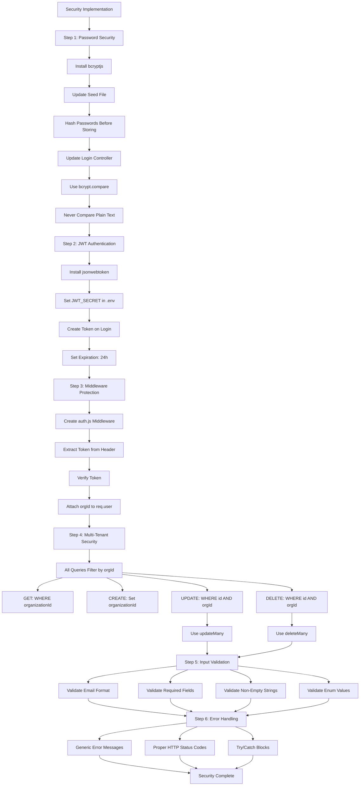

---

## 🧪 TESTING FLOW

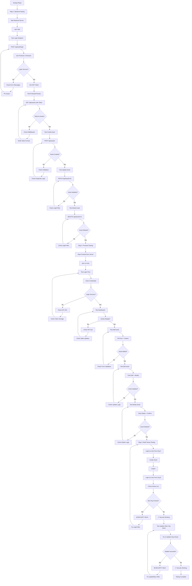

---

## 🚀 DEPLOYMENT FLOW

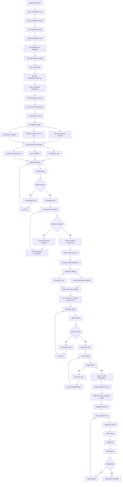

---

## 📁 FILE CREATION ORDER

```mermaid
flowchart TD
    A[Project Setup] --> B[Backend Files]
    A --> C[Frontend Files]
    
    B --> D[1. package.json]
    B --> E[2. .env]
    B --> F[3. prisma/schema.prisma]
    B --> G[4. src/db/prisma.js]
    B --> H[5. src/middleware/auth.js]
    B --> I[6. src/controllers/authController.js]
    B --> J[7. src/controllers/assetController.js]
    B --> K[8. src/server.js]
    B --> L[9. prisma/seed.js]
    
    C --> M[1. package.json]
    C --> N[2. .env]
    C --> O[3. src/api/axios.js]
    C --> P[4. src/components/Login.jsx]
    C --> Q[5. src/components/Dashboard.jsx]
    C --> R[6. src/components/AddAssetModal.jsx]
    C --> S[7. src/components/EditAssetModal.jsx]
    C --> T[8. src/App.jsx]
    C --> U[9. src/main.jsx]
```

---

## 🔄 COMPLETE DEVELOPMENT WORKFLOW

```mermaid
flowchart TD
    A[Start Development] --> B[Phase 1: Setup]
    B --> C[Initialize Projects]
    C --> D[Install Dependencies]
    D --> E[Configure Environment]
    
    E --> F[Phase 2: Database]
    F --> G[Create Schema]
    G --> H[Run Migrations]
    H --> I[Create Seed Data]
    
    I --> J[Phase 3: Backend Core]
    J --> K[Database Connection]
    K --> L[Authentication Middleware]
    L --> M[Login Controller]
    
    M --> N[Phase 4: Backend Features]
    N --> O[Asset Controller]
    O --> P[Routes Setup]
    P --> Q[Error Handling]
    
    Q --> R[Phase 5: Frontend Core]
    R --> S[API Configuration]
    S --> T[Login Component]
    T --> U[Dashboard Component]
    
    U --> V[Phase 6: Frontend Features]
    V --> W[Add Asset Modal]
    W --> X[Edit Asset Modal]
    X --> Y[Delete Functionality]
    
    Y --> Z[Phase 7: Security]
    Z --> AA[Password Hashing]
    AA --> AB[JWT Implementation]
    AB --> AC[Multi-Tenant Filters]
    AC --> AD[Input Validation]
    
    AD --> AE[Phase 8: Testing]
    AE --> AF[Backend API Testing]
    AF --> AG[Frontend Testing]
    AG --> AH[Multi-Tenant Security Testing]
    
    AH --> AI[Phase 9: Deployment]
    AI --> AJ[Database Deployment]
    AJ --> AK[Backend Deployment]
    AK --> AL[Frontend Deployment]
    AL --> AM[CORS Configuration]
    
    AM --> AN[Phase 10: Final Testing]
    AN --> AO[Test Production URLs]
    AO --> AP[Verify All Features]
    AP --> AQ[Project Complete]
```

---

## 🎯 LEARNING CHECKPOINTS

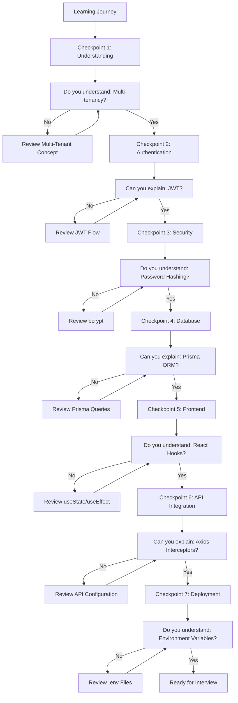

---

## 📚 KEY LEARNING POINTS BY PHASE

### Phase 1: Setup
- ✅ Node.js project initialization
- ✅ npm package management
- ✅ Environment variables (.env)
- ✅ Git version control

### Phase 2: Database
- ✅ Prisma schema definition
- ✅ Database relationships
- ✅ Migrations
- ✅ Seeding data

### Phase 3: Backend Core
- ✅ Express.js server setup
- ✅ Middleware pattern
- ✅ Route handlers
- ✅ Error handling

### Phase 4: Authentication
- ✅ JWT token creation
- ✅ Password hashing (bcrypt)
- ✅ Token verification
- ✅ Protected routes

### Phase 5: Multi-Tenancy
- ✅ Organization-based isolation
- ✅ Query filtering
- ✅ Secure update/delete operations
- ✅ Data isolation testing

### Phase 6: Frontend
- ✅ React component structure
- ✅ State management (useState)
- ✅ Side effects (useEffect)
- ✅ API integration

### Phase 7: Security
- ✅ Input validation
- ✅ Error message security
- ✅ CORS configuration
- ✅ Environment variable security

### Phase 8: Deployment
- ✅ Database hosting (Supabase)
- ✅ Backend hosting (Railway)
- ✅ Frontend hosting (Vercel)
- ✅ Environment configuration

---

## 🎓 RECOMMENDED LEARNING PATH

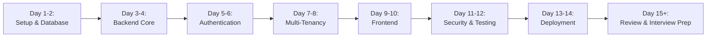

---

## ✅ COMPLETION CHECKLIST

### Backend
- [ ] Express server running
- [ ] Database connected
- [ ] Authentication working
- [ ] All CRUD operations working
- [ ] Multi-tenant security verified
- [ ] Error handling implemented

### Frontend
- [ ] Login page working
- [ ] Dashboard displaying assets
- [ ] Add asset working
- [ ] Edit asset working
- [ ] Delete asset working
- [ ] Error messages displayed

### Security
- [ ] Passwords hashed
- [ ] JWT tokens working
- [ ] Multi-tenant isolation verified
- [ ] Input validation on all endpoints
- [ ] CORS configured

### Deployment
- [ ] Database deployed (Supabase)
- [ ] Backend deployed (Railway)
- [ ] Frontend deployed (Vercel)
- [ ] All features working in production

---

**Use this flowchart to build the project step-by-step and understand each phase of development!**
