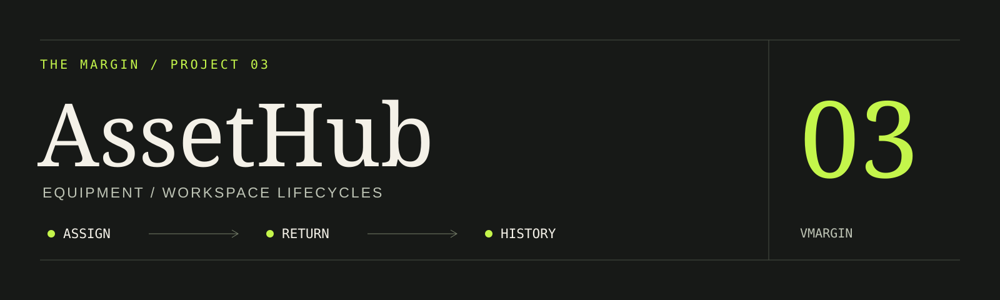
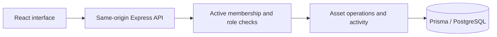

# ERL AssetHub

**Equipment lifecycle management with a workspace boundary around every operation.**

An educational multi-tenant inventory application for equipment, custodians, locations, checkout, maintenance, and audits. Its ivory/forest-green interface supports light, dark, and system appearance.

[Live demo](https://erlassethub.vercel.app/) · [Case study](https://vmargin.github.io/projects/assethub/)


## Implemented workflows

- Create organizations and switch between workspaces where you are an active member.
- Track equipment, categories, location hierarchies, custodians, purchase values, and warranties.
- Check out, return, transfer, and retire equipment while retaining lifecycle history.
- Import up to 250 assets atomically from CSV, export inventory, and print QR labels.
- Share one-use invitation links and manage OWNER, MANAGER, and MEMBER permissions.
- Report maintenance issues, record repairs, and reconcile location audits against inventory snapshots.
- Browse reports, activity notifications, global search, and organization settings.

**Demo access:** use the demo credentials displayed on the sign-in screen. Each demo session receives two isolated synthetic workspaces and expires after 24 hours; visitors do not enter an existing tenant. No real inventory or personal data is needed.

## Architecture and rules



The server checks active organization membership on workspace requests. Tenant-specific composite foreign keys protect related records. Asset transitions and activity commit together; a partial unique index permits one open checkout per asset. Assets retire rather than being deleted. The final active owner cannot be demoted or suspended, and inventory audits reject stale saves.

**Stack:** React 19, Vite, Express 5, Prisma 6, PostgreSQL. Vercel hosts the frontend and `api/index.js` on one origin. No separate Railway service or frontend API environment variable is required. Each server instance uses a small database pool; scaling needs an appropriate PostgreSQL pooler.

## Run locally

Use Node.js 24 and a dedicated PostgreSQL development database:

```powershell
git clone https://github.com/vmargin/assethub.git
cd assethub
npm ci --prefix backend
npm ci --prefix frontend
Copy-Item backend/.env.example backend/.env
```

Fill `DATABASE_URL` and a private random `JWT_SECRET` locally. Set `APP_URL=http://localhost:5173` for invitation and QR links. For a new, empty development database:

```powershell
cd backend
npx prisma migrate deploy
npm run dev
```

In a second terminal at the repository root, run `npm run dev --prefix frontend` and open http://localhost:5173. Vite proxies `/api` to port 5000.

Existing databases require a reviewed baseline. Never apply historical initialization migrations blindly to existing tables. The optional additive development seed requires `ALLOW_DEVELOPMENT_SEED=1` and `SEED_PASSWORD` and is disabled in production.

[Environment variables](ENV_SETUP.md) · [Deployment and rollback](docs/overhaul/deployment.md)

## Verify

```powershell
npm run lint --prefix frontend
npm run build --prefix frontend
npm run build --prefix backend
npm test --prefix backend
```

Database tests skip unless `RUN_DB_TESTS=1` is explicitly set. Enable that flag only with a dedicated development database: those tests create and clean synthetic fixtures. [Existing verification evidence](docs/overhaul/verification.md) records the earlier lifecycle, tenant, concurrency, browser, and deployment checks.

## Development with Sauron

Run `npm ci` at the repository root to install the pinned Sauron development harness.
Project and scoped `AGENTS.md` instructions automatically route relevant tasks to
Fellowship roles, architecture guidance and the complete frontend design-engineering
suite. Skills load on demand to keep small tasks lightweight.

Use `npm run ai:find -- "<task>"` to find applicable skills, `npm run ai:check` to
check the integration, and `npm run verify` for workflow tests, frontend lint/build
and Prisma validation/client generation, with architecture and formatting regressions.
`npm run ai:architecture` produces an AST dependency report. GitHub Actions also runs
API tests and `npm run test:browser` against a disposable PostgreSQL database.
Local browser checks require a dedicated local database in `AUDIT_DATABASE_URL`.
See the [execution evidence](docs/development/evidence/execution-report.md) and
[Sauron workflow and architecture map](docs/development/sauron.md)
for capability routing, setup, tool limitations and upgrade instructions.

Generated adapters and Fellowship configuration are not evidence that those
runtimes ran. Report actual specialist execution and verification results.

## Contribution and limits

I hand-coded the original. In v2 I used AI for frontend redesign and deployment. In v3 I used AI for redesign, development, and deployment, with user research informing feature selection. I review missing features, expected outputs, and behavior.

This is portfolio software. Invitations are shareable links; no email is delivered. Billing, SSO/SCIM, procurement automation, hardware discovery, and external integrations are outside scope. Reports use saved records rather than invented historical estimates.

[Feature research](docs/overhaul/research.md) · [Architecture](docs/overhaul/architecture.md) · [Dark screenshot](docs/overhaul/screenshots/dashboard-dark.png)

---

[More projects](https://github.com/vmargin) · [Portfolio](https://vmargin.github.io/) · [LinkedIn](https://www.linkedin.com/in/vmargin/)
