# System Flowchart - Multi-Tenant Asset Manager

## Complete System Flow from Login to All Operations

---

## 🔐 AUTHENTICATION FLOW

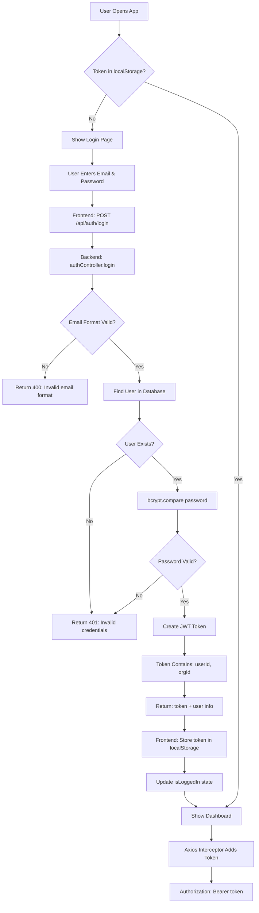

---

## 🛡️ PROTECTED ROUTE ACCESS FLOW

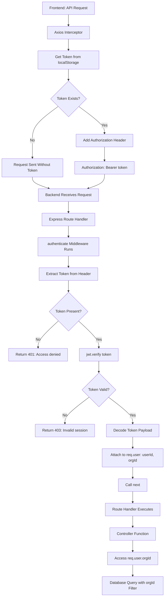

---

## 📦 GET ASSETS FLOW

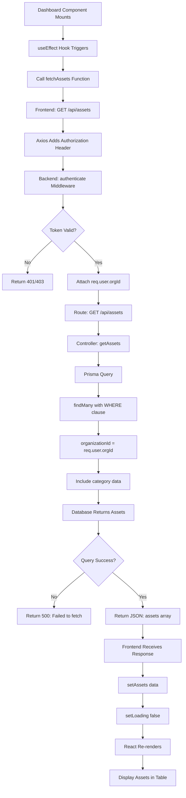

---

## ➕ CREATE ASSET FLOW

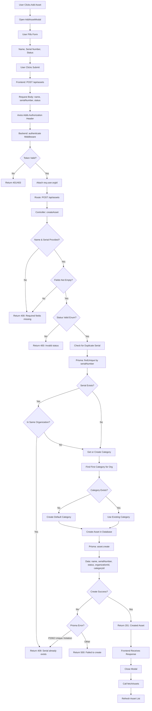

---

## ✏️ UPDATE ASSET FLOW

```mermaid
flowchart TD
    A[User Clicks Edit Button] --> B[Set selectedAsset State]
    B --> C[Open EditAssetModal]
    C --> D[Pre-fill Form with Asset Data]
    D --> E[User Modifies Fields]
    E --> F[User Clicks Save]
    
    F --> G[Frontend: PATCH /api/assets/:id]
    G --> H[Request Body: name, serialNumber, status]
    H --> I[URL Parameter: asset ID]
    I --> J[Axios Adds Authorization Header]
    J --> K[Backend: authenticate Middleware]
    
    K --> L{Token Valid?}
    L -->|No| M[Return 401/403]
    L -->|Yes| N[Attach req.user.orgId]
    
    N --> O[Route: PATCH /api/assets/:id]
    O --> P[Controller: updateAsset]
    
    P --> Q{ID Provided?}
    Q -->|No| R[Return 400: ID required]
    Q -->|Yes| S{At Least One Field?}
    
    S -->|No| T[Return 400: No fields to update]
    S -->|Yes| U{Fields Not Empty if Provided?}
    
    U -->|No| T
    U -->|Yes| V{Status Valid if Provided?}
    V -->|No| W[Return 400: Invalid status]
    V -->|Yes| X{Serial Number Changed?}
    
    X -->|Yes| Y[Check for Duplicate Serial]
    X -->|No| Z[Build Update Data Object]
    
    Y --> AA[Prisma: findUnique by serialNumber]
    AA --> AB{Serial Exists?}
    AB -->|Yes| AC{In Same Org & Different Asset?}
    AB -->|No| Z
    
    AC -->|Yes| AD[Return 409: Serial already exists]
    AC -->|No| Z
    
    Z --> AE[updateData: name?, serialNumber?, status?]
    AE --> AF[Prisma: updateMany]
    
    AF --> AG[WHERE: id = req.params.id AND organizationId = req.user.orgId]
    AG --> AH[Data: updateData]
    
    AH --> AI{Update Success?}
    AI -->|No| AJ[Return 500: Failed to update]
    AI -->|Yes| AK[Check updated.count]
    
    AK --> AL{Count > 0?}
    AL -->|No| AM[Return 404: Asset not found]
    AL -->|Yes| AN[Fetch Updated Asset]
    
    AN --> AO[Prisma: findUnique by id]
    AO --> AP[Include category data]
    AP --> AQ[Return 200: Updated Asset]
    
    AQ --> AR[Frontend Receives Response]
    AR --> AS[Close Modal]
    AS --> AT[Call fetchAssets]
    AT --> AU[Refresh Asset List]
```

---

## 🗑️ DELETE ASSET FLOW

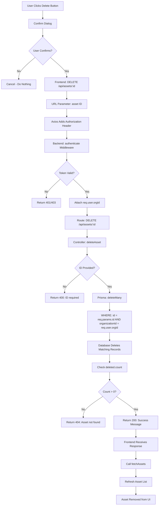

---

## 🔄 COMPLETE USER JOURNEY FLOW

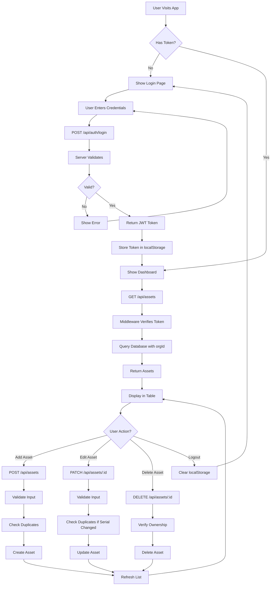

---

## 🔒 MULTI-TENANT SECURITY FLOW

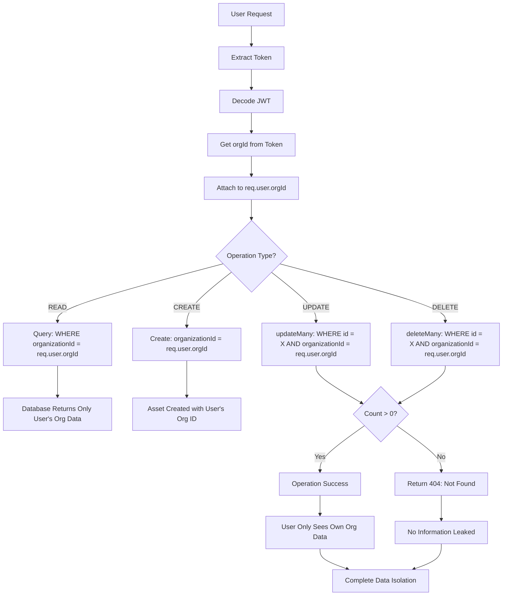

---

## 📱 FRONTEND STATE MANAGEMENT FLOW

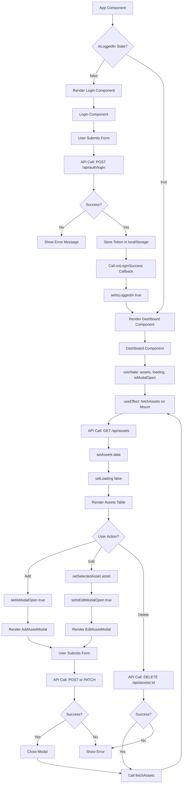

---

## 🗄️ DATABASE QUERY FLOW

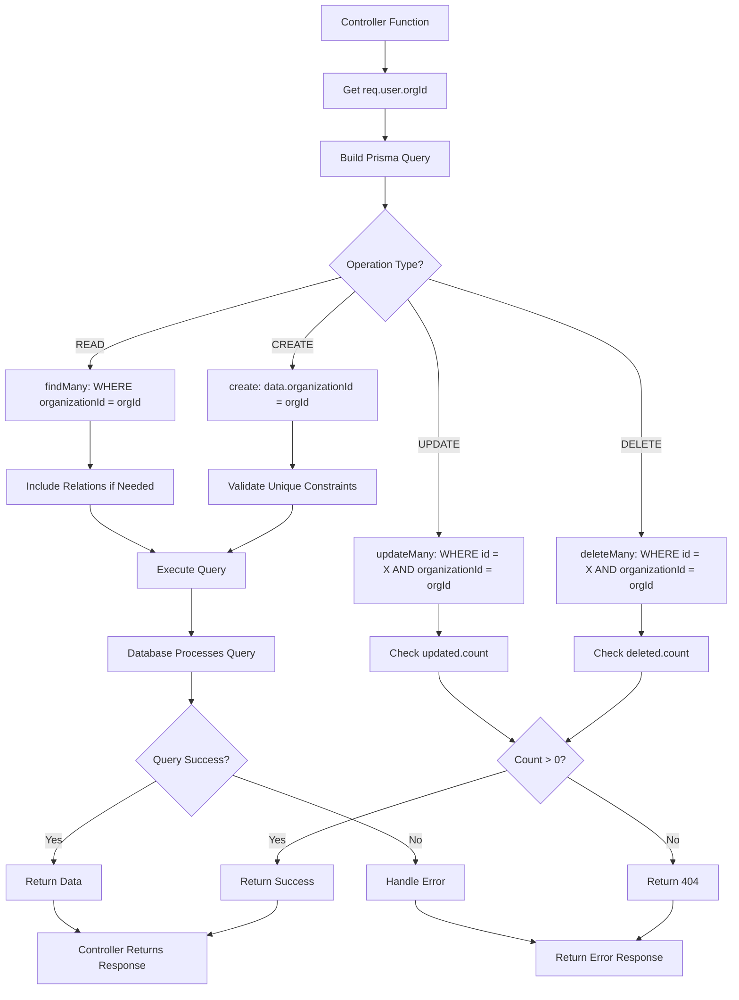

---

## 🔐 TOKEN LIFECYCLE FLOW

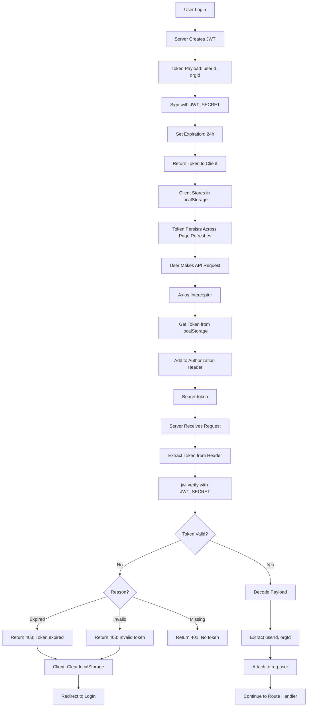

---

## 📊 COMPLETE SYSTEM ARCHITECTURE FLOW

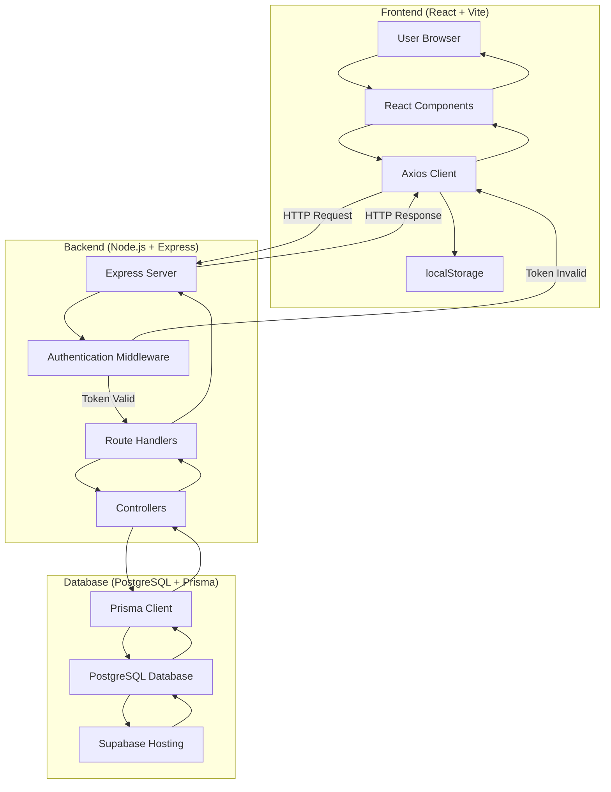

---

## 🎯 KEY SECURITY CHECKPOINTS

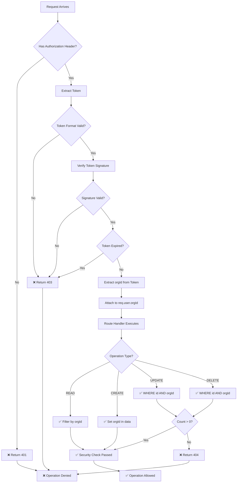

---

## 📝 SUMMARY

### Authentication Flow
1. User enters credentials → Server validates → JWT created → Stored in localStorage
2. Every request → Token extracted → Verified → orgId attached to request

### CRUD Operations Flow
1. **Read:** Filter by organizationId → Return only user's org data
2. **Create:** Validate input → Check duplicates → Set organizationId → Create
3. **Update:** Validate input → Check duplicates → Update with orgId filter → Verify count
4. **Delete:** Delete with orgId filter → Verify count → Return success/error

### Security Flow
1. Token verification on every protected route
2. organizationId included in every database query
3. updateMany/deleteMany ensure ownership before modification
4. Generic error messages prevent information leakage

---

**Use this flowchart to understand the complete system flow and explain it confidently in interviews!**
