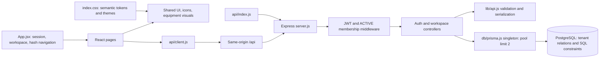

# Sauron in AssetHub

Sauron supplies development guidance and tools. AssetHub continues to run React
19/Vite, Express 5 and Prisma 6/PostgreSQL on Vercel. This integration adds no
application dependency, model call, background agent or startup hook.
The subsequent [execution pass](evidence/execution-report.md) applies the tools
to application code and records verified fixes, audits and browser evidence.

## Setup and automatic routing

Use Node.js 24. From the repository root:

```powershell
npm ci
npm run ai:check
npm run ai:find -- "review tenant authorization for asset transfers"
```

The root package pins `sauron-ai` to 3.0.0 and the npm lockfile pins its dependency
tree. Frontend/backend dependencies still use their existing separate installs.
Vercel's explicit install/build commands remain unchanged.

`AGENTS.md` is the persistent entrypoint for compatible agent runtimes. It routes
substantial tasks through the tracked `assethub-workflow` skill and frontend or
backend instructions. This is instruction-based automation; the runtime must read
the instructions and have tools to execute them. It does not install an agent
scheduler or guarantee that every editor discovers skills automatically.

`ai:find` uses Sauron's local ranked search over the pinned package, filtered by
enabled departments in `sauron.config.yaml`. It prints up to five matching paths.
Read the best matching skill and required references; do not load the catalog into
every task. Tiny fixes use direct inspection. The complete ecosystem is available
without copying thousands of vendor files or generating unused editor adapters.

All upstream `skills/`, `rules/`, `references/` and `core/` paths resolve relative
to `node_modules/sauron-ai/`. Ignore older unversioned `.agents/skills` copies and
generic runtime adapters from the previous setup. The tracked project skill is
the exception. `.codex/instructions.md` is a compatibility pointer, not the
automatic Codex entrypoint. No model, sandbox or approval policy is changed.

## Architecture and impact analysis

This map comes from inspection of the existing source, not a generated AST graph.
Follow the affected path before modifying a contract.



The backend has direct controller-to-Prisma access, without repository/service
layers. Frontend state and navigation live in `frontend/src/App.jsx`; there is no
router or global state library. Reuse these patterns. Read SQL migrations together
with `schema.prisma`: partial uniqueness and CHECK constraints are not fully
represented by Prisma's schema. Preserve active tenant membership checks, scoped
lookups, atomic history, concurrency guards, fixed audit snapshots, last-owner
protection and asset retirement. Read `docs/overhaul/architecture.md` for context,
distinguishing historical work descriptions from current code.

## Fellowship and workflow

All nine Fellowship specifications are available in the pinned package's
`core/fellowship/`. Actual agents depend on the runtime's delegation tools.

| Role | Use when |
| --- | --- |
| Gandalf | Substantial planning and coordination |
| Aragorn | Architecture, dependencies, contracts and schema impact |
| Frodo | Implementing the bounded task |
| Boromir | Authentication, tenant isolation, permissions and unsafe input |
| Merry | Meaningful regression strategy and verification |
| Pippin | Races, stale versions, malformed inputs and foreign resource IDs |
| Legolas | Syntax, lint, hooks and focused bug investigation |
| Gimli | Scoped refactors and dead code removal |
| Samwise | Git state, checkpoints and release preparation |

Independent tasks can run in parallel with explicit ownership. Shared files stay
with one owner. Small tasks use one agent; roles can also guide a local review.
Do not spawn nine agents for every change or claim personas ran just because they
are configured. This integration used real Aragorn and Legolas agents for the
architecture/frontend audits and Merry for workflow regression checks.

Apply engineering-loop stages as needed: a concise blueprint for substantial
work, UI token inspection for visual work, inspection after implementation,
context checkpoint for long work and failure triage when checks fail. Save useful
long-task context under `docs/development/`; do not create empty template trees or
repeat plans for a one-line edit. Current user instructions and project scope
govern implementation; upstream generic templates do not mandate incidental
framework changes or extra confirmation for already authorized reversible work.

Architecture, backend, database, frontend, quality, security, DevOps and workflow
departments are searchable by default. AI engineering remains available in the
package and can be enabled when a task actually introduces an AI feature. Other
frameworks and cloud platforms are similarly available on demand.

## Frontend design engineering

Start with `skills/frontend/design-engineering/SKILL.md` in the pinned package.
Its current router covers the complete suite:

| Capability | Appropriate use |
| --- | --- |
| Foundations | Critique, visual identity, UI library evaluation, design spec export, variants |
| Styles | Deliberate visual direction for a requested new surface or redesign |
| Brand | Moodboard prompts, brand presets and existing identity consistency |
| Motion | Vocabulary, gap scan, planning, component polish and PR review |
| Image to code | Supplied visual references, page/screen prompts and implementation |
| Audit | Responsive screenshots, layout fixes, code/component review and completeness |

Foundation references cover layout, type, color, surfaces, icons/images, component
states, motion, copy and accessibility. Load the index and relevant references.
Use AssetHub's actual `frontend/src/index.css` tokens and shared components from
`components/UI.jsx`, `Icon.jsx` and `AssetVisual.jsx` instead of replacing them
with a generic token sheet. Preserve DM Sans, Newsreader, warm neutrals, forest
actions and light/dark/system appearance. `docs/overhaul/design.md` is the visual
contract; its historical deployment permission is not continuing authorization.

Use the suite's React guidance in JSX/plain CSS. It is not a request to migrate to
TypeScript, Tailwind, Next.js, server components or a new animation library. Brand
presets, glass effects, landing-page patterns and image generators are optional
tools for matching tasks, not automatic restyling instructions. The old design
document mentions `emil-design-eng`; that skill is not installed and must not be
reported as executed.

Material UI changes cover real loading/empty/error/success/disabled states, both
themes, keyboard/focus behavior, contrast, reduced motion and responsive layouts.
The suite's six check widths are 320, 375, 425, 768, 1024 and 1440px. Scope small
fixes to the affected breakpoint plus mobile/desktop. Browser, image-generation
and axe evidence require those tools to actually run. `axe-core` exists as a
frontend development dependency. `npm run test:frontend` runs formatting
regressions; `npm run test:browser` runs the local rendered audit and lifecycle
checks with pinned Playwright/Chromium, using a dedicated local database.

## Working tools and their limits

| Command | Actual behavior in the pinned release |
| --- | --- |
| `npm run ai:check` | Checks installed/locked pin, project entrypoints, configured role specifications and routed skill paths |
| `npm run ai:find -- "task"` | Local ranked search using Sauron's finder, restricted to enabled departments |
| `npm run ai:scan` | Scans only application JS/JSX with Sauron's sink heuristics; emits SARIF on findings and fails on error findings |
| `npm run ai:architecture` | Executes the project-owned Babel AST fallback, writes graph evidence and fails on cycles, unresolved relative imports or crossed frontend/backend boundaries |
| `npm run ai:benchmark` | Compares formatting against Git HEAD, checks output equivalence and records local timings without a flaky performance threshold |
| `npm run test:browser` | Starts isolated local servers, exercises UI lifecycle/focus flows and audits rendered pages across themes and viewport widths |
| `npm run sauron -- list-skills` | Lists the upstream catalog, including domains disabled for default project search |
| `npm run sauron -- worktree-plan "task one" "task two"` | Prints a plan; does not create worktrees or launch agents |
| `npm run sauron -- mcp-index` | Prints skill resource metadata; does not install or connect an MCP server |
| `npm run sauron -- trace-report <events.json>` | Summarizes supplied events; no automatic tracing is configured |
| `npm run sauron -- init --yes --dry-run` | Previews native generation; review its generic instructions before any real sync |

The native `graph` command fails in the published 3.0.0 package because
`scripts/graph/generate-graph.mjs` is omitted. The project-owned
`npm run ai:architecture` fallback parses actual JSX/CommonJS/ESM imports using
pinned Babel and emits JSON/Markdown under `docs/development/evidence/architecture`.
These are explicitly labeled fallback artifacts, not native Sauron output.

Native `status` prints supported runtimes rather than checking local installation.
Native `fitness` scans only immediate .ts/.mjs files with upstream layer rules,
so it does not validate this JavaScript/JSX architecture. Native `diff` supplies
empty current-checksum maps; it is not a usable workspace drift check here.
`registry-build` starts from an empty list. These are not verification gates.

The sink scanner is a small line-pattern check that skips full-line comments. It
does not parse full JavaScript semantics or verify tenant isolation. Native
package scoring does not fetch registry metadata. Use real dependency audits,
focused review and regression tests for security claims. Configured security
preferences are declarative: this setup does not install a command firewall or
change runtime permissions. Agent instructions still protect secrets and data.

Do not run native `sync` blindly: it generates generic root instructions and
adapters that can conflict with this project. Versioned project guidance is
maintained directly. To upgrade, review the new exact package version, update the
lockfile, inspect routed paths, run workflow tests and verification, then review
the diff. No global installation is required.

## Verification

```powershell
npm run verify
npm run ai:scan
```

The GitHub Actions workflow runs these on pull requests and pushes with Node 24.
It checks the integration, workflow/architecture/frontend regressions, AST
boundaries, frontend lint/build and Prisma validation/client generation. It then
starts a disposable PostgreSQL 18 service, applies migrations, executes API tests
with RUN_DB_TESTS=1 and runs the browser audit. It uploads execution evidence and
screenshots. Its synthetic credentials are confined to that job's local database.

Backend behavior tests require `RUN_DB_TESTS=1` and a verified dedicated
development database. Do not silently enable them against an unknown connection.
Install Chromium once with `npx playwright install chromium --only-shell`.
Set AUDIT_DATABASE_URL to the dedicated local PostgreSQL URL for browser checks;
the runner rejects non-loopback hosts and database names other than
assethub_execution or assethub_test. The database needs the existing migrations.
The runner reserves ports 50581/50582, cleans only the synthetic demo IDs created
by its run and stops its own servers. It never uses the project's existing .env
database for browser tests. Do not run two browser audits concurrently.

Existing screenshots and
`docs/overhaul/verification.md` are historical evidence, not results of this
execution pass. The root build commands do not deploy or apply migrations to an
existing configured database.

Initial setup validation on 2026-10-23 used Windows, Node 24.12.0 and npm 11.17.0. All 14 workflow
tests passed with no skips; frontend lint/build, Prisma validation/generation and
integration checks passed. The heuristic scan inspected 19 application files with
zero findings. The root development dependency audit reported zero vulnerabilities.
Database behavior and browser checks were not run because application code was
unchanged. The GitHub Actions workflow was added and inspected locally; its remote
execution has not been observed in this task.
